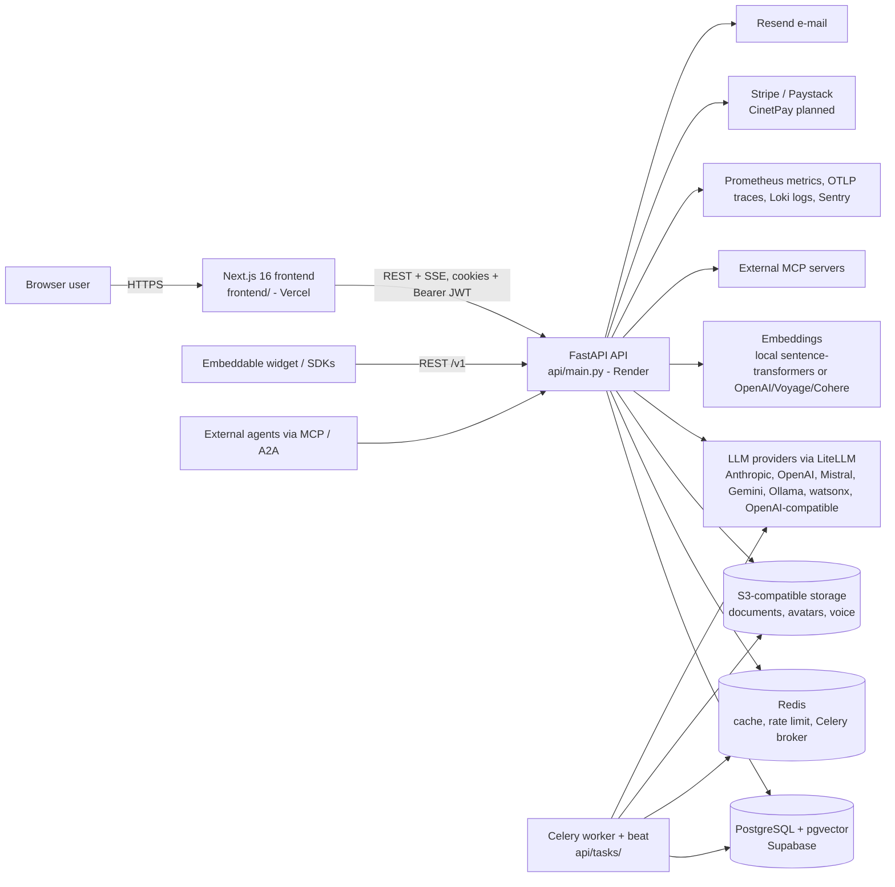
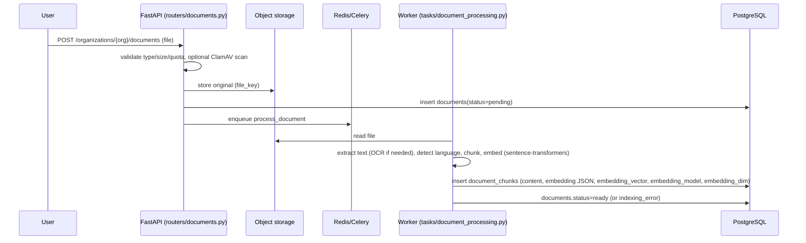

# 03 - Technical architecture (as implemented)

Evidence tags: **[V]** read in code during this mission, **[R]** run in project sessions, **[D]** documented in the repo only, **[U]** unknown. Machine-generated inventories: `annex/python_modules.md`, `annex/database_tables.md`, `annex/api_routes.csv`, `annex/frontend_pages.csv`.

## 1. System context



## 2. Technology stack [V: `requirements-api.txt`, `frontend/package.json`, `Dockerfile.api`]
| Layer | Technology | Notes |
|---|---|---|
| Language/runtime | Python 3.13 (`python:3.13-slim-bookworm`; `agents.md` still says 3.11 - a documented discrepancy) | |
| API | FastAPI 0.141.1, Uvicorn 0.52.4 / gunicorn (`gunicorn.conf.py`), Pydantic v2 + pydantic-settings | one OpenAPI document |
| ORM / DB | SQLAlchemy 2.0.40 async + asyncpg 0.31; Alembic migrations (`api/alembic/versions`, `alembic.ini`) | PostgreSQL 16/17 + pgvector 0.8.x |
| Vectors | pgvector `Vector(384)` with HNSW index (migration 0128) + NumPy fallback | see 04 |
| Lexical search | `rank_bm25` BM25Okapi in memory, per-organization cache with invalidation | O(N) per organization on a cold cache |
| Reranker | cross-encoder `cross-encoder/ms-marco-MiniLM-L-6-v2` (sentence-transformers) | |
| Background | Celery 5.6.3 + Redis; beat schedule in `api/tasks/celery_app.py` (62 periodic entries) | |
| LLM | LiteLLM 1.99.0 plus direct adapters in `api/services/llm_providers.py` | |
| Auth | PyJWT, bcrypt 5.0 password hashing (passlib deliberately not used), pyotp (TOTP), webauthn, authlib/OAuth | |
| Frontend | Next.js 16.3.x, React 19.2, TypeScript, Tailwind CSS, Vitest, Playwright (separate `e2e/` package) | |
| Policy | OPA over an internal HTTP client (opa-python-client removed), Casbin for custom RBAC | OPA off by default (`OPA_ENABLED=False`) |
| Observability | prometheus-client, OpenTelemetry OTLP/HTTP, Loki handler, Sentry, optional Langfuse/Datadog LLM Obs | all optional/blank by default |
| IaC | Docker Compose (self-hosted + observability), Helm chart, Kubernetes manifest, Terraform (AWS, GCP, Azure, DigitalOcean), Render/Fly/Railway files | validated with the official tools, never applied [R] |

## 3. Repository layout (commented)
```
rag-saas-platform/
├── api/                     Backend (FastAPI)
│   ├── main.py              App assembly: lifespan, SessionMiddleware, CORS (+ regex for Vercel previews), security-headers middleware, 113 include_router calls
│   ├── config.py            ~2,500 lines: every setting (pydantic-settings). Env file selected by RAG_ENV_FILE (default .env)
│   ├── database.py          async engine + get_db dependency; pool sized small for Supabase poolers
│   ├── dependencies.py      get_current_user, require_* dependencies
│   ├── models/              90 files -> 182 SQLAlchemy tables (see annex/database_tables.md)
│   ├── routers/             107 files: HTTP layer, one file per domain (documents, agents, billing, ...)
│   ├── security/            72 files: "domain logic with access control" (CRUD that checks permissions), auth primitives (jwt, totp, webauthn, rate_limit, csrf, encryption)
│   ├── services/            290 files: business logic (RAG pipeline, agents, evaluation, billing, 40 *_extraction.py connectors, etc.)
│   ├── tasks/               50 files: Celery tasks (document_processing, imports, reindex, billing, retention, alerts, ...)
│   ├── tools/               10 files: agent tools (search_kb, web_search, url_reader, sql_tool, github_tools, email/calendar, human_escalation, calculator)
│   ├── alembic/versions/    143 migrations (0001..0143)
│   └── ... (middleware, mcp helpers, workflows)
├── frontend/                Next.js app (app/ pages, components/, lib/ api.ts i18n.tsx branding, hooks/, widget/)
├── sdks/                    python / js / react / vue (v0.1.0)
├── packages/                n8n-nodes-rag-saas, make-rag-saas
├── src/                     LEGACY single-tenant FastAPI-docs RAG prototype (still imported by some scripts/tests)
├── dashboard/               LEGACY Streamlit UI
├── bob/ , docs/ibm_bob_2/   IBM Bob 2.0 contest material and experiments
├── tests/                   512 test files (see annex/tests_inventory.csv); tests_pipeline/ for the legacy RAG regression
├── e2e/                     Playwright package (separate node_modules)
├── scripts/                 operations: migrate.py (rehearsal+apply), backup.sh, post_deploy_smoke.py, run_tests_local.sh, staging_validate.py, ...
├── deploy/                  render, fly, railway, helm, kubernetes, terraform/{aws,gcp,azure,digitalocean}, dedicated-tenant
├── docs/                    documentation (architecture, api, DECISIONS.md, HANDOVER.md, runbooks, project-handover/ = this dossier)
├── audit-reports/           functional audit of the 514 features (CSVs + reports)
├── locales/                 fr/en translation sources (synced into frontend by scripts/sync_frontend_locales.py)
├── .github/workflows/       ci, mypy, bandit, e2e, llm-tests, migrate, post-deploy-smoke, celery-worker
├── .circleci/config.yml     regression-check workflow: rag-pipeline-regression, api-tests
├── render.yaml              FOSSIL: describes the Streamlit prototype ("nova-fastapi-assistant")
└── README.md, ROADMAP.md, ARCHITECTURE.md, CHANGELOG.md, agents.md, AUDIT.md, SECURITY.md
```

## 4. Backend layering and conventions [V]
* **Router** (`api/routers/x.py`): declares the route, injects `db: AsyncSession = Depends(get_db)` and a permission dependency (`require_permission("documents:write")`, `get_current_user`, API-key dependencies for the public API), calls a service/security function, maps domain exceptions (ValueError subclasses) to 4xx.
* **`api/security/x.py`**: despite the name, it is the *data-access layer with authorization* for a domain (e.g. `security/documents.py` is a 3,400+ line module holding `process_document`, embedding generation, chunk persistence). Treat "security/" as "domain core".
* **`api/services/x.py`**: pure-ish business logic and integrations (LLM calls, retrieval, extraction, billing providers).
* **Models** use SQLAlchemy 2.0 `Mapped[...]`; UUID primary keys; most tenant tables carry `organization_id` (83 of 182 tables).
* **Settings** are read from `api.config.settings` and from per-organization JSON in `organization_settings` (`DEFAULT_SETTINGS` in `api/security/organization_settings.py`, merged by `get_org_settings`). Precedence: explicit call argument > organization setting > global setting.
* **Errors:** domain exceptions (`GenerationBlockedError`, `LLMError`, `AgentGuardrailError`, `PublicAPIError`) are ValueError/Exception subclasses mapped by routers. A global handler (`api/db_errors.py`) maps database errors.
* **Async:** all request paths are async; CPU-heavy work (embedding, classifier) uses `asyncio.to_thread`; Celery tasks run in separate processes and create their own async engine (`api/tasks/_db.py`, `_sync_engine.py`).
* **Per-request state:** `ContextVar`s are used for log correlation (`security/logging_correlation.py`) and for connector credential scope (`services/connector_credentials.py`).
* **Caching:** `services/cache_service.py` (Redis, generic), BM25 index cache in `retrieval_pipeline.py`, HTTP cache headers where relevant.
* **Rate limiting:** `security/rate_limit.py` and `adaptive_rate_limit.py`, Redis-backed; applied on selected routes (auth, search, public API), not globally (see 06).
* **Logging:** structured logging with correlation ids, optional Loki handler, DB `system_logs` handler (`security/system_log_handler.py`).

## 5. Application start-up and middleware [V: `api/main.py`]
`lifespan()` runs startup validations (configuration validators such as the dotenv selection, secret strength) then yields. Middleware stack: `SessionMiddleware` (OAuth state; `https_only=COOKIE_SECURE`), `CORSMiddleware` (allow-list `frontend_urls_list` + regex for this project's Vercel preview URLs, credentials allowed), a security-headers middleware (HSTS, CSP, X-Frame-Options, Referrer-Policy added after audit finding 1.1), and a second HTTP middleware (line ~261 of `api/main.py`; per-request correlation/metrics). Exact behaviour of that second middleware was not read in detail. Metrics endpoint `/metrics` is protected by `METRICS_AUTH_TOKEN` when set.

## 6. Background processing [V]
Celery app `api/tasks/celery_app.py` registers task modules (document processing, imports for GitHub/Drive/Docs/Notion/OneDrive/Confluence/sitemap/url/zip, reindex and scheduled reindex, evaluation and comparison jobs, workflows, billing, notifications, retention, account purge, token blacklist cleanup, JWT key rotation, SSL renewals, A/B tests, media backfills, agent memory consolidation, guardrail checks, fine-tuning status, plugin validation, partner commissions, security scans, alert rules, analytics aggregates...).
**Beat schedule** (62 entries): daily purges (deleted accounts, conversations, voice messages, audit logs), `requeue-stale-pending-documents`, `check-scheduled-reindexes` (every minute), `check-scheduled-workflow-triggers` (every minute), hourly API-key and quota jobs, monthly invoices and compliance report, daily credit grants and auto-refill, alert-rule evaluation, plugin validation, A/B significance, media backfill, memory consolidation.
**Consequence of no worker/beat in production:** uploaded documents stay `pending`/`processing` (the web process only enqueues), imports never run, scheduled purges/invoices/alerts never fire. The documented zero-cost workaround is `.github/workflows/celery-worker.yml` (a worker started every 10 minutes on a GitHub runner for a bounded window); it does not run beat, so periodic tasks are not covered by it [V/D]. The paid blueprint `deploy/render/render.api.yaml` defines web + worker + beat + a maintenance cron.

## 7. Data flows (main paths)
### 7.1 Upload -> searchable

### 7.2 Question -> streamed answer with citations
```mermaid
sequenceDiagram
  participant U as User (chat)
  participant R as routers/chat_stream.py
  participant P as retrieval_pipeline.search_with_context
  participant O as AgentOrchestrator.stream_response
  participant L as LLM (LiteLLM)
  participant DB as PostgreSQL
  U->>R: POST stream (agent, message)
  R->>P: retrieve chunks (org-scoped; strategy, filters)
  P->>DB: pgvector HNSW query and/or BM25 over org chunks
  P-->>R: citation_chunks
  R->>R: build_llm_context(); no-context refusal if required
  R->>O: context + citation_chunks
  O->>O: validate_guardrails (input, retrieved context) incl. injection detector
  O->>L: stream with tools (function calling loop, max 8 iterations)
  O-->>U: SSE events: start, thinking, token, citation, done
  O->>DB: persist Response + Citations + confidence + quality metrics; debit credits
```
Detail of each step in `04_RAG_PIPELINE_DEEP_DIVE.md`.

## 8. Deployment topology
Documented target [D: README]: frontend on **Vercel** (`rag-saas-platform-rho.vercel.app`), API on **Render** (`rag-saas-api-sjsm.onrender.com`), database on **Supabase** (pgvector, session/transaction pooler), Redis and object storage as configured by environment variables. API container: multi-stage `Dockerfile.api` (non-root user, `INSTALL_OPTIONAL_RAG_DEPS` build arg to include heavy ML dependencies). The database engine is deliberately small (pool size 5, overflow 10) because Supabase pooler limits total client connections; the transaction-mode pooler (port 6543) is used by the application [V comments in `api/database.py`]. See `10_TESTS_CI_CD_AND_DEPLOYMENT.md`.

## 9. Mandatory vs optional components
| Component | Needed for | Mandatory in production? |
|---|---|---|
| PostgreSQL + pgvector | everything | **Yes** |
| Redis | rate limiting, Celery, caches | **Yes** (Celery/limits degrade without) |
| Celery worker | document processing, imports, purges, scheduled jobs | **Yes** for a usable product |
| Celery beat | periodic jobs | Yes for retention, invoices, alerts, reindex schedules |
| S3-compatible storage | uploaded files, avatars, voice | Yes for uploads |
| LLM provider key (or BYOK, or Ollama) | answers | Yes |
| Resend (e-mail) | verification, resets, notifications | Yes for sign-up flow |
| ClamAV | antivirus on upload | Optional (off by default) |
| OPA, GraphRAG, Mem0, Tavily, Twilio, STT/TTS | optional features | Optional |
| Prometheus/Grafana/Loki/Tempo/Sentry | monitoring | Strongly recommended, not required |
| Payment provider | charging customers | Required to sell; **none usable now** |
