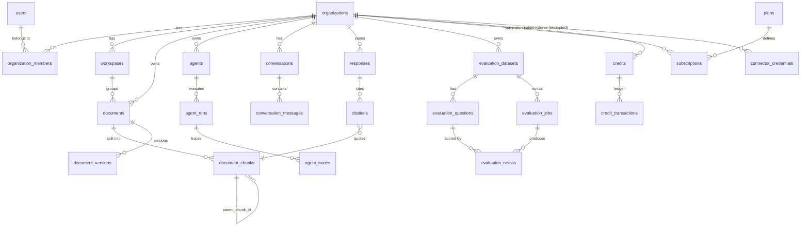

# 07 - Database and migrations

Tags: **[V]** read from code or generated from SQLAlchemy metadata on 2026-10-12; **[R]** executed in project sessions; **[D]** documented only; **[U]** unknown. Full machine-generated detail: `annex/database_tables.md` (every column, foreign key, index of the 182 tables), `annex/database_tables.csv`, `annex/migrations.csv`. Column types in the annex are SQLAlchemy's generic (SQLite-dialect) rendering (`CHAR(32)` stands for UUID); in PostgreSQL ids are `uuid`.

## 1. Engine, connection and conventions
* PostgreSQL (production: Supabase) with the **pgvector** extension (`CREATE EXTENSION IF NOT EXISTS vector` in migration 0128; server version observed 0.8.2 on 2026-10-06 [D]). SQLAlchemy 2.0 async + asyncpg; one `AsyncSession` per request (`api/database.py::get_db`).
* The application uses Supabase's pooler. A production error (`EMAXCONNSESSION`, 2026-09-17) led to a small explicit pool (size 5, overflow 10) and a move to the transaction-mode pooler (port 6543) in the application, session mode (port 5432) for tools such as `pg_dump` [V comments in `api/database.py`; D].
* Primary keys are UUIDs generated in Python (`default=uuid.uuid4`). Timestamps `created_at/updated_at`; soft delete via `deleted_at` on documents, conversations, datasets.
* JSON columns hold flexible configuration (`organization_settings`, `agents.guardrails_config`, `evaluation_questions.expected_documents`, `document_chunks.metadata_json`).
* **Test databases:** the default pytest fixture is in-memory **SQLite** (with `Vector` degrading to JSON); PostgreSQL tests use their own fixtures and run in CI against a disposable pgvector container since D8.

## 2. Inventory by domain (182 ORM tables + `casbin_rule`; `*` = has `organization_id`)
| Domain | Tables |
|---|---|
| **Identity & sessions** | `users`, `oauth_accounts`, `sessions`, `password_reset_tokens`, `email_verification_tokens`, `password_history`, `two_factor_recovery_codes`, `two_factor_lockout_recovery_tokens`, `account_restore_tokens`, `consent_records`, `consent_reactivation_tokens`, `revoked_access_tokens`, `jwt_signing_keys`, `key_rotation_history`, `webauthn_credentials`, `enterprise_sso_connections`, `enterprise_sso_accounts`, `scim_tokens*` |
| **Tenancy & access** | `organizations`, `organization_members*`, `organization_settings*`, `organization_quotas*`, `organization_usage*`, `organization_usage_details*`, `organization_branding*`, `organization_llm_configs*`, `organization_api_keys*`, `invitations*`, `workspaces*`, `teams*`, `team_members`, `resource_permissions*`, `custom_roles*`, `user_custom_roles`, `permissions`, `permission_groups`, `role_permissions`, `casbin_rule` (Casbin policy store: created by migration 0016 but **not** part of the ORM metadata, so the real table count in a migrated database is 183), `custom_domains*`, `ssl_certificates`, `acme_accounts` |
| **Knowledge base** | `documents*`, `document_chunks*` (text + embeddings), `document_versions`, `document_tags*`, `document_tag_assignments`, `document_audit_logs`, `document_images`, `document_keywords`, `document_entities`, `external_sources*`, `reindex_schedules*`, `batch_jobs*`, `batch_job_items`, `media_assets*`, `media_frames`, `media_transcripts`, `connector_credentials*` |
| **Conversations & answers** | `conversations*`, `conversation_messages`, `conversation_shares`, `message_feedback`, `message_edit_history`, `regeneration_history`, `follow_up_questions`, `responses*`, `citations`, `retrieval_diagnostics*`, `flight_recordings*` |
| **Agents** | `agents*`, `agent_runs*`, `agent_traces`, `agent_steps`, `agent_sessions`, `agent_memories`, `agent_memory_items`, `agent_long_term_memory_items`, `agent_plans`, `agent_collaborations`, `agent_api_keys`, `autonomous_agents*`, `task_plans`, `task_steps`, `tool_permissions*`, `tool_timeout_overrides`, `tool_budgets`, `tool_fallbacks`, `llm_fallbacks`, `custom_tools*`, `human_approvals*`, `escalations*`, `escalation_notes`, `mcp_server_configs*`, `mcp_tool_cache` |
| **Workflows** | `workflows*`, `workflow_versions`, `workflow_triggers`, `workflow_runs`, `workflow_node_executions`, `workflow_human_inputs` |
| **Evaluation & quality** | `evaluation_datasets*`, `evaluation_questions`, `question_sets`, `question_set_items`, `evaluation_jobs`, `evaluation_results`, `evaluation_failures`, `manual_evaluations`, `comparison_jobs`, `benchmark_versions`, `regression_thresholds*`, `regression_detections`, `deployment_evaluations`, `ab_tests*`, `ab_test_assignments`, `ab_test_results`, `rag_experiments*`, `alert_rules*`, `alert_channels*`, `alert_history`, `incidents*` |
| **Billing** | `plans`, `subscriptions*`, `payment_customers*`, `payment_events`, `invoices*`, `invoice_lines`, `credits*`, `credit_transactions*`, `coupons`, `coupon_redemptions*`, `usage_alerts*`, `licenses*`, `partner_commissions`, `resellers*`, `sub_clients*` |
| **Integrations & channels** | `integration_connections*`, `integration_mappings`, `integration_logs`, `airbyte_connections*`, `webhooks*`, `webhook_deliveries`, `slack_integrations*`, `slack_messages`, `teams_integrations*`, `teams_messages`, `discord_integrations*`, `discord_messages`, `sms_messages*`, `call_records*`, `voice_messages`, `voice_settings`, `widget_configs*`, `widget_suggested_questions` |
| **Marketplace & fine-tuning** | `plugins*`, `plugin_installations*`, `plugin_versions`, `plugin_reviews*`, `plugin_executions*`, `fine_tuning_datasets*`, `fine_tuning_jobs*`, `fine_tuned_models*`, `fine_tuning_evaluations`, `sandbox_environments*` |
| **Security & compliance** | `audit_logs*`, `audit_logs_archive*`, `security_policies*`, `security_scans*`, `security_alerts*`, `vulnerabilities`, `data_requests`, `data_breaches*`, `encryption_key_records`, `encryption_audit`, `system_logs` |
| **Notifications & analytics** | `notifications*`, `notification_preferences*`, `notification_templates*`, `analytics_events*`, `analytics_aggregates*`, `analytics_dashboards*`, `support_tickets*`, `support_ticket_responses` |

### 2.1 Core entity relationships

### 2.2 Details for the most important tables [V]
* **`documents`** (23 columns): `organization_id`, `workspace_id`, `name`, `file_key` (S3), `file_size`, `file_type`, `status`, `metadata_json`, `content_hash` (indexed with organization and file type for duplicate detection), `current_version_id`, soft delete (`deleted_at/by`), indexing status (`indexing_started_at`, `indexing_error`), modification tracking (`last_modified`, `last_checked`), `reindex_schedule`.
* **`document_chunks`** (14): `document_id` (nullable: media chunks use `media_asset_id`), `organization_id` (added by 0047 for tenant-scoped search), `content`, `metadata_json`, `embedding` (JSON list - the portable copy), `embedding_model`, `embedding_dim`, **`embedding_vector Vector(384)`** (HNSW index; only populated when the dimension is 384), `chunk_index`, `parent_chunk_id` (self FK) and `chunk_role` for parent/child chunking. Indexes: document, media asset, organization, parent.
* **`responses` / `citations`**: one `Response` per answer (query, answer, confidence, hallucination metrics, `retrieval_strategy`, `embedding_model`, `llm_provider`, `llm_model`, `flight_recording_id` = provenance added in 0130) and its `Citation`s (chunk, document, location, passage, relevance).
* **`evaluation_*`**: see `04_RAG_PIPELINE_DEEP_DIVE.md` section 5.1. Tenancy exists only on `evaluation_datasets`; jobs/results/questions inherit via `dataset_id`.
* **`credits` / `credit_transactions`**: balance and an append-only ledger (`grant`, `consume`, `purchase`, refund types) used for the prepaid model (D13).
* **`organizations`**: includes `bm25_corpus_revision` (BigInt advanced by triggers) used to invalidate cached BM25 indexes across processes.
* **`connector_credentials`** (0143): `(organization_id, provider)` unique, `encrypted_payload` (AES-GCM), `created_by`, timestamps; RLS enabled, no policy.

## 3. Migrations (Alembic, `api/alembic/versions`, 143 files, linear, single head `0143` [V])
### 3.1 Chronology
| Range | Content |
|---|---|
| 0001-0013 | Authentication: users, OAuth, sessions, reset tokens, RLS enablement (0002), 2FA recovery, consent, restore tokens, token revocation, `users.role` (0010), password history, audit log, JWT keys + WebAuthn + enterprise SSO |
| 0014-0030 | Organizations, workspaces, Casbin rules, resource permissions, teams, invitations, quotas, member limits, usage, settings, branding, custom domains, SSL/ACME, email-domain verification |
| 0031-0047 | Documents and chunks, tags, versions, soft delete, audit, indexing status, content hash, modification tracking, external sources, reindex schedules, batch jobs, images, keywords/entities, `document_chunks.organization_id` |
| 0048-0065 | Agents: runs, tool permissions/timeouts/budgets/fallbacks, approvals, memory, conversations, task plans, traces, escalations, agents, guardrails, API keys, workflows, custom tools |
| 0066-0082 | Responses & citations, hallucination metrics, **Evaluation Lab** (0071-0077), message actions, shares, follow-ups, voice |
| 0083-0098 | Public API keys, widget, Slack/Teams/Discord, "RLS on every table still missing it" (0087), custom RBAC & compliance (0088), admin (0089), billing (0090), alerting (0091), integrations, SMS, sales models, plugin marketplace, RLS gap fix (0098) |
| 0099-0112 | Partner commissions, white-label, analytics, advanced A/B, multimodal + CLIP, autonomous agents, fine-tuning, **AI credits & BYOK (0109)**, workflow state, parent/child chunks |
| 0113-0127 | embedding NULL backfill, widget domains, **Paystack/Stripe multi-provider (0115)**, notifications, long-term memory, MCP servers, retrieval diagnostics, performance indexes, evaluation failures, sandbox, prompt-injection flag, RAG experiments, flight recordings |
| 0128-0136 | **pgvector (0128)**, account lock-out (0129), response provenance (0130), RLS on 11 tables (0131), workspace description, **BM25 revision triggers (0133)**, SSO domain verification (0134), call-record tenancy (0135), notification templates (0136) |
| **0137-0143** | **Applied to production on 2026-10-11**: eval split, escalation SLA/notes, feedback correction, coupons, SCIM tokens, `users.job_title`, connector credentials |
### 3.2 Safety properties
* Only **one** upgrade drops a column: `0010` (`users.is_superadmin` replaced by `users.role`, with data conversion). Six migrations alter column types/nullability (0019, 0047, 0088, 0100, 0104, 0115 [3 alterations]). All of 0137-0143 are additive (new nullable columns/new tables) and reversible [V].
* 0128 requires the `vector` extension; 0133 creates triggers on chunk/document tables; 0113 is a one-time data backfill.
* Rule from `agents.md`: never edit an existing migration; fix forward with a new one.
* `scripts/migrate.py` = **rehearsal** (generates the SQL offline, runs all pending migrations inside one transaction that is always rolled back, reports pass/fail) and `--apply` (rehearsal then `alembic upgrade head`). Used on 2026-10-11 for 0136 -> 0143: rehearsal passed, apply succeeded, `alembic current` = `0143 (head)` [R].
### 3.3 Environment parity
| Environment | Revision | Evidence |
|---|---|---|
| Production (Supabase) | **0143** | applied 2026-10-11 by the owner after a backup [R]. Before that: 0136 (the README "operator checkpoint" of 2026-10-06 said 0130, 178 tables) |
| CI (GitHub) | head (fresh database, all migrations applied) | `backend-tests` job [R] |
| Local test stack | head, but a persistent test database can lag (a stale database at 0137 failed 7 OAuth tests until `alembic upgrade head` was re-run) | [R] |
| Staging | [U] a Supabase staging project was provided once; no authenticated session was ever established from the working environment |
Production table count after 0143 should be 182 minus tables not created by migrations (the model metadata has 182; production had 178 before 0131-0143, consistent with the 4+ tables added since) - **not re-counted**.

## 4. Integrity and consistency analysis
### 4.1 Verified properties [V]
* Cascades and foreign keys: tenant child tables reference their parents; `document_chunks.document_id` or `media_asset_id` must be set (media cascade removes chunks); `documents.created_by`/`deleted_by` reference users.
* Duplicate prevention: composite index on (organization, content hash, file type); batch and upload dedupe in code.
* Concurrency: `SELECT ... FOR UPDATE` on credit balances (`billing_credits.py` lines ~112 and ~173) and on invoices (`billing_invoices.py`); 24 PostgreSQL concurrency tests (credits, invoices, subscriptions) passed on a scratch database [R]. Spend-cap atomicity under heavy concurrency is **not proven** (BILL-012).
* A migration for a table the code used but no migration created (`notification_templates`) was found by the audit and added (0136) - the generic lesson: compare `Base.metadata` with the migrated schema in CI.
### 4.2 Gaps and risks
| Risk | Detail | Status |
|---|---|---|
| Models vs schema drift | Previously, tables defined in models but never migrated; no automated drift check was found in CI | **[U] open**: recommended CI step `alembic check` / autogenerate diff on a fresh database |
| Orphan data | Soft deletes leave chunks until purge; derived stores (Mem0 collections, LightRAG graph, Redis caches, flight recordings, lineage) are cleaned by explicit calls, not by FK cascades | partially handled (see 06 section 10) |
| Foreign keys absent | Evaluation results hold `agent_id` FK but no `organization_id`; some JSON ids (e.g. `expected_documents` document ids) are not FKs; earlier audits listed "missing foreign keys" | JSON references are validated optionally (`verify_documents` on import); no DB constraint |
| No RLS policies | see 06 section 4.2 | open by decision |
| Mixed embedding spaces | see 04 section 2.2 | open, low frequency |
| Backup/restore | custom-format dump exists; **restore never rehearsed** | open |
| Index maintenance | HNSW index only for 384-d; larger organizations rely on NumPy fallback for other dimensions; BM25 O(N) per cold cache | known limit |
